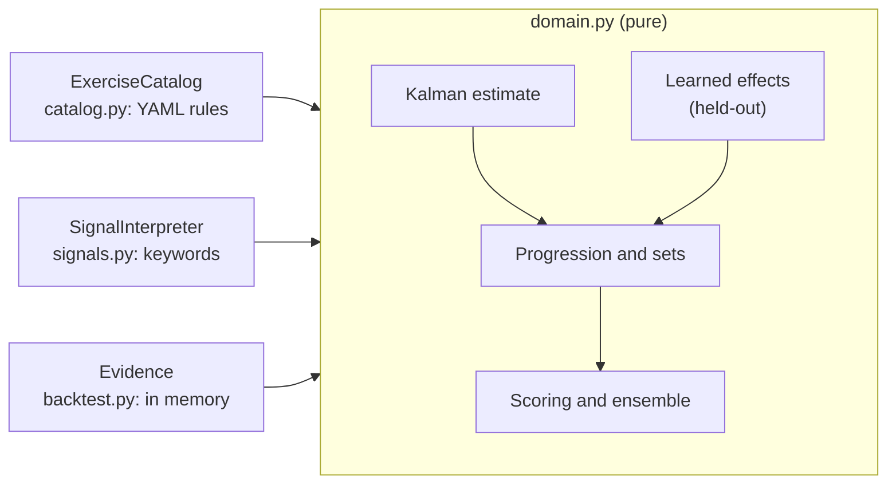

# The Human Model

[](https://github.com/haleyparks329/the-human-model/actions/workflows/public-repo-checks.yml)

A longitudinal model of one person that keeps what was observed, what was
inferred and what was confirmed apart, and learns from its own predictions.
I built it for my own training: it runs every night against my workout log,
messages and health data, predicts what I will lift in my next session, and
scores itself against what I actually did.

This repository publishes the prediction engine with a synthetic athlete, so it
runs without anyone's data, and the research and architecture behind it. The
production system (Postgres ledgers, workout-app sync, the coaching agent that
uses it) is private because it holds my health data.

## Run it

```bash
python3 -m pip install -e '.[test]'
python3 -m human_model_lift backtest     # walk-forward backtest on a synthetic athlete
python3 -m human_model_lift predict      # next session, with the reason for every number
python3 -m pytest
```

`predict` prints each recommendation with its contributors:

```text
Deadlift (Barbell): 5 x 110.0 kg, 5 x 110.0 kg, 5 x 110.0 kg   (expected 110.0 kg)
    progression_type   none           Named in a current strength goal or block
    strength_estimate  base           e1RM 115.6±9.8 kg from 16 sessions; trend +0.75 kg/week
    sleep              none           0 of last 3 nights >1 h under the 7.4 h median
    hrv_rhr            none           HRV 55 ms vs 56±8; resting HR 59 vs 58±3
```

## How it predicts

For each lift in the next routine, several models predict the working sets and
an ensemble combines them. Every run and every outcome is stored, so the models
are judged on their record, not on how plausible they sound.

| Model | What it does |
|---|---|
| `lift-kalman-v1` | A Kalman filter tracks each lift's estimated one-rep max (Epley) and its trend, with noise settings recalibrated nightly from the athlete's own history. Strength lifts step from the last session toward the estimate (capped at +10%); rep-range lifts use double progression. |
| `same-as-last-v1` | Baseline: repeat the last session. Every model has to beat it. |
| `ensemble-v1` | Equal-weight average until each model has 20 scored outcomes, then inverse recent error shrunk halfway to equal (equal weights usually win on little data). |

What the athlete says is read as typed signals ("my elbow feels weird" is pain in
a region; "it flew" is easy). A signal changes the **recommendation** at once, for
example a pain report holds the load on exercises that load that joint. It changes
the **expected** load only after it is learned: at least 20 outcomes with it and 20
without, a consistent direction, and an effect fitted on the older two thirds that
also improves the newest third. Until then it is shown as a note.

Details: [docs/lift-model.md](docs/lift-model.md).

## What it found

On my real log (68 walk-forward predictions, September to October 2026), the
expected top-set load was off by **2.4 kg** on average against **2.6 kg** for
"same as last time" and 3.2 kg for "last + 2.5 kg". On strength lifts the gap was
larger: 8.3 kg against 13.3 kg. A small sample, so the nightly scoring is the
real measure.

Three findings changed the design ([full write-up](docs/lift-model-findings.md)):

1. **What I say did not predict what I lift.** Adding tiredness and stress
   signals made predictions worse. I often lifted more after saying I was
   exhausted. Signals now shape the recommendation, and only effects that pass a
   held-out check shift the expectation.
2. **No readiness score predicted performance.** Six scores modeled on WHOOP-,
   Oura-, Garmin- and Apple-style inputs, an HRV guideline and my own reports had
   rank correlations between −0.15 and 0.16 with how I lifted over 39 days. So
   missing wearable data is no longer a reason to be cautious.
3. **Learning needs held-out evidence.** Effects fitted on all outcomes looked
   real and made the next predictions worse. The held-out rule adopted none of
   them, which was the right answer.

On the synthetic athlete in this repository (119 predictions, three seeds) the
result is mixed, and that is the case for combining models: the ensemble is best
overall on all three seeds; the Kalman model beats the baseline on rep-range
lifts (0.6–0.7 kg against 1.0 kg) but overshoots on strength lifts. The generator
is calibrated to how often loads change in my real log, not to make any model win.

## Architecture

The engine is hexagonal: the domain is pure functions, and everything it needs
from the world comes through a port, so each adapter can be replaced.



| Port | Adapter here | In production |
|---|---|---|
| `ExerciseCatalog` | YAML exercise rules: identity across apps, equipment step, substitution groups for swaps | Same |
| `SignalInterpreter` | Keyword reader with a body-part window and a negation guard | The coaching agent's structured reading of each message, with keywords as fallback |
| `Evidence` | In-memory synthetic athlete | Postgres: workout log, shared message record, check-ins, Apple Health |
| `Ledger` | (not needed for the backtest) | Append-only Postgres tables; a trigger rejects updates and deletes |

Practices that carry over from the private system:

- **Walk-forward evaluation only.** Each prediction uses data from before its session.
- **A baseline every model must beat**, kept in the registry permanently.
- **Append-only ledgers** for predictions and outcomes, so the record cannot be
  quietly rewritten.
- **A science journal.** Every experiment is an append-only entry with question,
  method, result and decision, including the ones that failed. The findings
  above come from it.

## The research question

> How can a system remain useful across time without reducing a person to a
> static profile or treating uncertain evidence as fact?

The lift engine is one application of a broader model: observations become
evidence, interpretations and claims stay reviewable, and only explicit
confirmation makes something canonical. Corrections supersede rather than
overwrite, missing data stays missing, and each consumer gets only the projection
it needs. Read [Why the Human Model](docs/why-the-human-model.md),
[Architecture](docs/architecture.md) and [Design principles](docs/design-principles.md).

It runs inside [Wonderful Digital World](https://github.com/Wonderful-Digital-World/wonderful-digital-world),
where agents (a coach among them) read bounded projections of it.

## Repository map

| Path | What it is |
|---|---|
| `src/human_model_lift/` | The prediction engine, synthetic athlete and backtest |
| `tests/` | Engine tests |
| `examples/` | A small evidence-and-provenance review toy |
| `docs/` | Lift model, findings, architecture and research notes |
| `demo/`, `assets/` | Earlier prototypes (movement analysis, dashboard, chat) kept as history |

## Limits

Estimates measure working capacity at my usual effort, not tested maximums (I do
not log reps in reserve). The real-data results come from one person over a few
months. The engine does not make medical judgments.
