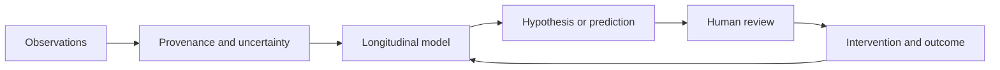
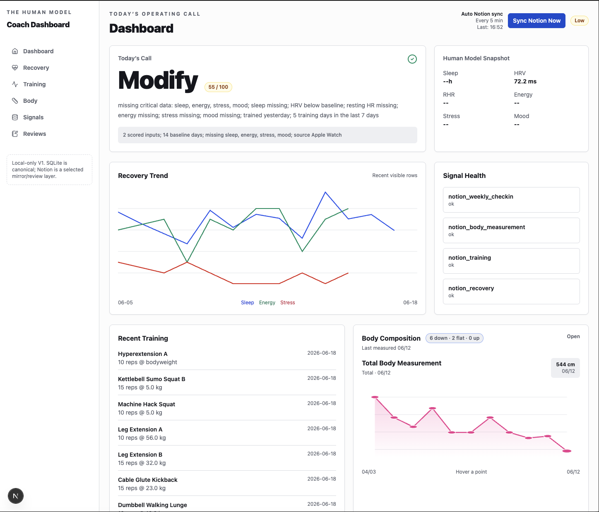

# The Human Model

The Human Model is a long-running research project about representing one person as longitudinal, reviewable evidence rather than a pile of disconnected records.

Its central question is simple: can software connect observations, context, uncertainty, hypotheses, interventions, and outcomes over time without pretending that partial evidence is certainty?

This public repository is the evidence and explanation layer for that work. It demonstrates product reasoning, architecture boundaries, research artifacts, screenshots, and deliberately simplified examples. It is not a deployable health system or a copy of the private implementation.

## The model loop



The model owns domain evidence, interpretations, hypotheses, and evaluation. Interfaces may help capture or present context, but they do not own the model. Bridget is one possible bounded continuity interface; it is a separate system and is not the Human Model's database, orchestrator, or source of truth.

## What the public work demonstrates

- longitudinal evidence with source provenance
- explicit missingness and uncertainty
- separation of observation, interpretation, and decision
- predictions evaluated against later outcomes
- human review and correction before stronger automation
- product surfaces for review, including a coach dashboard and movement-analysis prototype
- honest implemented, experimental, and future boundaries

## Explore the project

1. Read [Why the Human Model](docs/why-the-human-model.md).
2. Review the [public architecture](docs/architecture.md) and [evidence map](docs/evidence-map.md).
3. Run the [toy evidence review](examples/README.md).
4. Explore the approved [dashboard screenshots](assets/asset-manifest.md) and [movement-analysis demo](demo/mediapipe-rdl-form/README.md).
5. Read the [design principles](docs/design-principles.md), [movement-analysis notes](docs/movement-analysis.md), and [research notes](docs/research-notes.md).

## Toy example

The only executable model example is intentionally incomplete. It accepts three fictional observations, preserves their provenance, and classifies each claim as `supported`, `partial`, or `unsupported`. It contains no health-device contract, readiness score, weights, thresholds, calibration, routing, prompt, storage schema, or recommendation logic.

```bash
python3 examples/toy_evidence_review.py
python3 -m unittest examples/tests/test_toy_evidence_review.py
```

## Public evidence



The screenshots and demo media show real product surfaces where approved. They demonstrate how evidence and uncertainty can be reviewed; they do not expose the contracts or machinery behind those surfaces.

## Status

Implemented concepts include evidence capture, review surfaces, recovery and training experiments, and a narrow movement-analysis prototype. Calibration, broader sensing, and stronger intervention evaluation remain experimental. Public claims are intentionally narrower than the private research system.

## Intentionally withheld

The public repository does not include production contracts, private data models, ingestion adapters, real schemas, prompts, thresholds, weights, calibration logic, routing rules, tool permissions, runtime composition, deployment details, or private repository maps.

## Safety boundary

This is research and decision-support work, not medical advice. Public examples are synthetic and are not suitable for health or training decisions.
