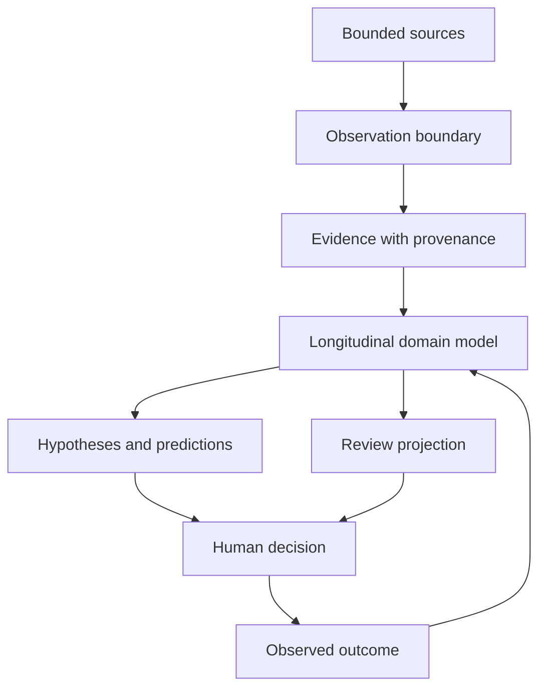

# Public Architecture

The Human Model is a domain model, not an interface, chatbot, database, or universal orchestration layer.

## Ownership boundaries

- The Human Model owns its domain evidence, provenance, interpretations, hypotheses, evaluation records, and corrections.
- Source systems own their original records.
- Review surfaces present model state; they do not become the source of truth.
- A bounded interface such as Bridget may carry references or request context. It does not own Human Model evidence or decisions.
- Humans retain authority where evidence is incomplete, conflicting, or consequential.

## Architectural commitments

1. Preserve source and provenance beneath every interpretation.
2. Represent missingness instead of silently filling gaps.
3. Keep observations separate from hypotheses and decisions.
4. Make model changes and corrections inspectable.
5. Evaluate predictions against later outcomes.
6. Keep domain behavior independent of any one interface.

This document intentionally omits production schemas, adapters, storage choices, orchestration, thresholds, calibration, and deployment composition.
